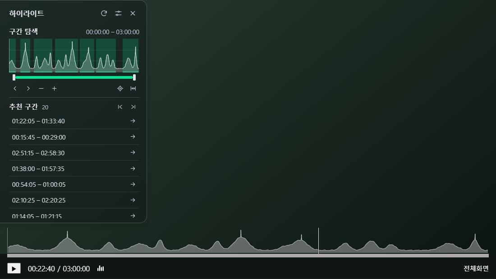

# 치지직 하이라이트 그래프

치지직 다시보기에서 채팅 반응이 몰린 장면을 찾는 Chrome 확장 프로그램입니다. 그래프가 높을수록 같은 영상 안에서 채팅 반응이 강했던 순간입니다.

**[최신 릴리스에서 설치 ZIP 받기](https://github.com/vov-y/chzzk-highlight-graph/releases/latest)**

## 설치

1. 릴리스의 **설치 ZIP 다운로드** 링크에서 ZIP을 내려받아 압축을 풉니다.
2. Chrome 주소창에 `chrome://extensions`를 입력하고 **개발자 모드**를 켭니다.
3. **압축해제된 확장 프로그램을 로드합니다**를 누르고, 압축을 푼 폴더 중 `manifest.json`이 들어 있는 **`chzzk-highlight-graph`** 폴더를 선택합니다.
4. 이미 열려 있던 치지직 다시보기 탭은 새로고침합니다.

## 하이라이트 찾기

1. 치지직 다시보기를 열고 **재생 시간 옆 막대그래프 버튼**을 누릅니다. 기본 단축키는 **H**입니다.
2. 처음 연 영상은 채팅 분석이 끝날 때까지 기다립니다. 자동 분석을 껐다면 패널에서 **분석 시작**을 누릅니다.
3. **추천 구간**에서 시간대를 누르면 해당 구간의 시작으로 이동하고 그래프가 확대됩니다. 기본 추천은 점수가 높은 구간 최대 20개입니다.
4. 전체 점수 그래프를 보려면 영상 재생바에 마우스를 올립니다. 재생바 위나 패널 안의 그래프에서 원하는 지점을 **클릭**하면 해당 시각으로 이동하고, 범위를 **드래그**하면 그 구간이 확대됩니다. 패널의 **전체 범위**를 누르면 그래프가 영상 전체를 표시합니다.

치지직에서 미리보기를 제공하는 영상은 재생바, 그래프, 탐색 범위 바에 커서를 올리거나 드래그할 때 썸네일을 볼 수 있습니다. 분석 점수가 있으면 썸네일 시간 옆에 표시됩니다.

## 추천 범위와 정렬

1. 패널의 그래프를 드래그하거나 아래 범위 바의 손잡이를 움직여 원하는 시간대를 고릅니다.
2. **이 범위에서 추천**을 누르면 선택한 시간대가 **추천 범위**에 표시됩니다. 다른 시간대를 탐색하거나 추천 항목을 눌러도 적용한 추천 범위는 유지됩니다.
3. 범위를 바꾸려면 새 시간대를 고른 뒤 **이 범위로 변경**을 누릅니다. 전체 영상의 추천을 보려면 **전체 추천**을 누릅니다.

목록 오른쪽의 **점수순 / 시간순** 버튼은 누를 때마다 바뀝니다. **시간순**은 같은 추천 목록을 시작 시각이 빠른 순서로 표시합니다.

*테스트 플레이어의 예시 점수로 표시한 화면입니다.*

## 영상 설정

패널의 **영상 설정**에서 **개수 / 비율** 버튼을 눌러 추천 목록의 크기를 정하는 기준을 바꿀 수 있습니다. 값을 **0**으로 두면 추천 항목 표시를 끕니다. 지표별 가중치를 **0**으로 두면 해당 지표를 제외합니다. 추가로 감지할 반응 키워드는 한 줄에 하나씩 입력합니다. 각 항목의 설명은 마우스를 올리면 표시됩니다.

현재 영상 설정은 자동 저장됩니다. 여러 영상에 공통으로 쓸 값이나 패널 단축키를 바꾸려면 **기본 설정**을 열고 저장합니다. 기존 영상에 새 기본값을 적용하려면 해당 영상에서 **영상 설정을 기본값으로 복원**을 누릅니다.

## 분석이 안 될 때

- 치지직에서 재생할 수 있는 다시보기인지 확인합니다. 채팅이 적거나 영상이 짧으면 추천 구간이 비어 있을 수 있습니다.
- 특정 시간대의 추천이 비어 있다면 범위를 넓혀 보거나 **영상 설정**에서 현재 추천 개수 또는 비율을 확인합니다.
- 채팅을 새로 불러오려면 패널의 **다시 분석** 버튼을 누릅니다.

채팅과 분석 결과는 이 브라우저에 저장됩니다. **영상 설정** 또는 **기본 설정**에서 **분석 캐시 삭제**를 누르면 저장된 모든 영상의 채팅과 분석 결과를 지웁니다.
